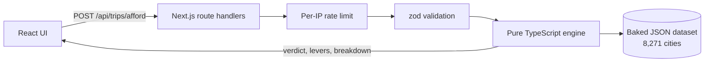

# Can I Afford This Trip?

[](https://github.com/Ramy3077/TravelProject/actions/workflows/ci.yml)

Enter a trip and a budget. Get a yes or no, how many days the budget covers, and the changes that would bring the cost down.

**Live demo: https://web-production-a9b34.up.railway.app**

**These are estimates, not live prices.** They come from a 2019 cost-of-living dataset adjusted for inflation to 2024, plus modelled fares. Nothing is fetched from a booking site.


## How the estimate works

The cost model is a pure TypeScript engine inside the app, so every request gets an answer without calling an outside API.

- **Fallback chain.** Accommodation, food and local transport come from cost-of-living data for the destination city. If the city has no data, the country median is used, then a global default. Each step down lowers the confidence tag on that line.
- **Levers.** The engine reruns itself with one change at a time: a cheaper tier, fewer nights, a cheaper month, a cheaper substitute city, or one fewer traveller. Substitutes must be in the same country, or a neighbour in the same region within 600 km, and of similar city size, so Lisbon never gets Morocco. Changes that save money are ranked by saving, and clicking one applies it.
- **Tiers.** Budget, Balanced and Comfort change every category: airfare class, type of stay, food spend and local transport. They are defined in one file, [`tiers.ts`](web/src/lib/engine/tiers.ts).
- **Seasonality.** The trip month sets a peak (x1.2), shoulder (x1.0) or off-season (x0.85) multiplier, flipped for the southern hemisphere.
- **Transport.** Return airfare comes from a distance-banded curve, so short hops cost more per km than long-haul. It is a model, not a live fare, so its confidence is capped at medium.
- **Verdict.** Estimated cost up to 80% of the budget is comfortable, up to 100% is within budget, up to 110% is tight, and above that is over.
- **Currency.** The engine works in USD. The page converts at the edges (budget in, figures out) to GBP, USD or EUR using fixed reference rates stored in the dataset meta, with their date shown in the footer.

## Architecture (v2)



One Next.js 16 app, deployed on Railway from `web/Dockerfile` (standalone output): React 19, TypeScript, Tailwind v4, zod. The engine in [`web/src/lib/engine`](web/src/lib/engine) has no framework imports and no I/O, so it is unit-tested directly with vitest. The dataset is built from CSVs by [`web/scripts/build-dataset.ts`](web/scripts/build-dataset.ts) and committed as JSON, so there is no database.

The rate limiter is in memory, so each running instance keeps its own counts and a restart resets them. It stops bursts from one client; an exact quota across several instances would need a shared store such as Redis.

API: `POST /api/trips/afford`, `POST /api/trips/estimate`, `GET /api/locations/cities?q=`, `GET /api/health`.

## The v1 backend

`api/` and `worker/` hold the first version (Spring Boot, a Python ETL worker, Postgres, live Amadeus fares). It is kept for reference, not deployed, and CI still builds the Java module. v2 replaced it with the single app above.

## Run locally

```bash
cd web && npm install && npm run dev
```

Then open http://localhost:3000. Checks: `npm run lint`, `npx tsc --noEmit`, `npm test`, `npm run build`.

## Data sources

SimpleMaps World Cities (cities and coordinates), OurAirports (airport codes), a Numbeo-derived cost-of-living dataset from Kaggle (~2019), and World Bank CPI (`FP.CPI.TOTL`). The engine's figures are USD estimates, not quotes.
