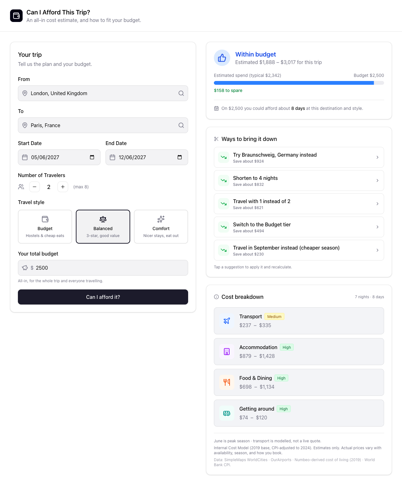
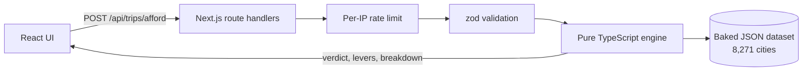

# Can I Afford This Trip?

[](https://github.com/Ramy3077/TravelProject/actions/workflows/ci.yml)

Enter a trip and a budget. Get a yes or no, how many days the budget covers, and the changes that would bring the cost down.

**Live demo: https://web-production-a9b34.up.railway.app**

**These are estimates, not live prices.** They come from a 2019 cost-of-living dataset adjusted for inflation to 2024, plus modelled fares. Nothing is fetched from a booking site.



## How the estimate works

The cost model is a pure TypeScript engine inside the app, so every request gets an answer without calling an outside API.

- **Fallback chain.** Accommodation, food and local transport come from cost-of-living data for the destination city. If the city has no data, the country median is used, then a global default. Each step down lowers the confidence tag on that line.
- **Levers.** The engine reruns itself with one change at a time: a cheaper tier, fewer nights, a cheaper month, a cheaper substitute city, or one fewer traveller. Substitutes must be in the same country, or a neighbour in the same region within 600 km, and of similar city size, so Lisbon never gets Morocco. Changes that save money are ranked by saving, and clicking one applies it.
- **Tiers.** Budget, Balanced and Comfort change every category: airfare class, type of stay, food spend and local transport. They are defined in one file, [`tiers.ts`](web/src/lib/engine/tiers.ts).
- **Seasonality.** The trip month sets a peak (x1.2), shoulder (x1.0) or off-season (x0.85) multiplier, flipped for the southern hemisphere.
- **Transport.** Return airfare comes from a distance-banded curve, so short hops cost more per km than long-haul. It is a model, not a live fare, so its confidence is capped at medium.
- **Verdict.** Estimated cost up to 80% of the budget is comfortable, up to 100% is within budget, up to 110% is tight, and above that is over.
- **Currency.** The engine works in USD. The page converts at the edges (budget in, figures out) to GBP, USD or EUR using fixed reference rates stored in the dataset meta, with their date shown in the footer.

## Architecture (v2)



One Next.js 16 app, deployed on Railway from `web/Dockerfile` (standalone output): React 19, TypeScript, Tailwind v4, zod. The engine in [`web/src/lib/engine`](web/src/lib/engine) has no framework imports and no I/O, so it is unit-tested directly with vitest. The dataset is built from CSVs by [`web/scripts/build-dataset.ts`](web/scripts/build-dataset.ts) and committed as JSON, so there is no database.

API: `POST /api/trips/afford`, `POST /api/trips/estimate`, `GET /api/locations/cities?q=`, `GET /api/health`.

## The v1 backend

`api/` and `worker/` hold the first version (Spring Boot, a Python ETL worker, Postgres, live Amadeus fares). It is kept for reference, not deployed, and CI still builds the Java module. v2 replaced it with the single app above.

## Design decisions and trade-offs

- **TypeScript rewrite instead of keeping Spring Boot.** The alternative was to keep v1 (Spring Boot, a Python worker, Postgres, Amadeus fares) and fix it. The real logic is a distance calculation, table lookups and some multiplication, so a JVM service added cold starts for little gain, and Amadeus is shutting down its self-service API. Cost: no live fares, and the v1 code still sits in the repo.
- **Baked JSON instead of Postgres.** v1 read city and cost data from Supabase, whose free tier pauses on inactivity, which broke the app when nobody used it. The data is static reference data (1.4 MB of JSON), so it is built from CSVs and committed. SQLite was the other option; JSON avoided a native module across dev, CI and Docker, behind the same `DataContext` interface. Cost: every instance holds the whole dataset in memory, and new data needs a rebuild and redeploy.
- **In-memory, per-instance rate limit.** A sliding window per client IP, held in an LRU, instead of a shared store such as Redis. The app runs as one instance, so this stops bursts from one client with no extra service. Cost: counts are per instance and reset on restart, so scaling out would loosen the limit.
- **2019 data adjusted by CPI instead of fresh paid data.** Current city-level cost data is paid (Numbeo API). The 2019 Kaggle figures are scaled per country by World Bank CPI (2019 to 2024) at build time. Cost: general CPI is not the same as hotel or restaurant inflation, and countries without a CPI factor keep their 2019 numbers.
- **Fixed FX rates instead of a live feed.** GBP and EUR use ECB reference rates stored in the dataset meta, with their date in the footer. This keeps every request free of outside calls. Cost: conversions drift from the market until the rates are updated by hand.
- **Modelled airfare instead of a fare API.** A distance-banded curve, with confidence capped at medium. Skyscanner is partner-only and Kiwi needs an existing audience, so a model was the free option. Cost: real fares on a given route and date can sit well outside the range.

## Known limitations

- Costs are estimates from 2019 data, not prices. Cities without their own cost data fall back to the country median or a global default.
- Airfare ignores airline, route competition and how far ahead you book.
- The rate limit is per instance and resets on restart.
- FX rates are fixed and go stale until updated.
- The engine works in USD only; GBP and EUR are converted at the edges.
- Trips are capped at 30 nights and 8 travellers.

## Run locally

```bash
cd web && npm install && npm run dev
```

Then open http://localhost:3000. Checks: `npm run lint`, `npx tsc --noEmit`, `npm test`, `npm run build`. `npm test` runs the engine unit tests and the integration tests in [`web/test/integration`](web/test/integration), which call the real route handlers over the real dataset (valid trips, 400s, 404s and 429s).

## Data sources

SimpleMaps World Cities (cities and coordinates), OurAirports (airport codes), a Numbeo-derived cost-of-living dataset from Kaggle (~2019), and World Bank CPI (`FP.CPI.TOTL`). The engine's figures are USD estimates, not quotes.
